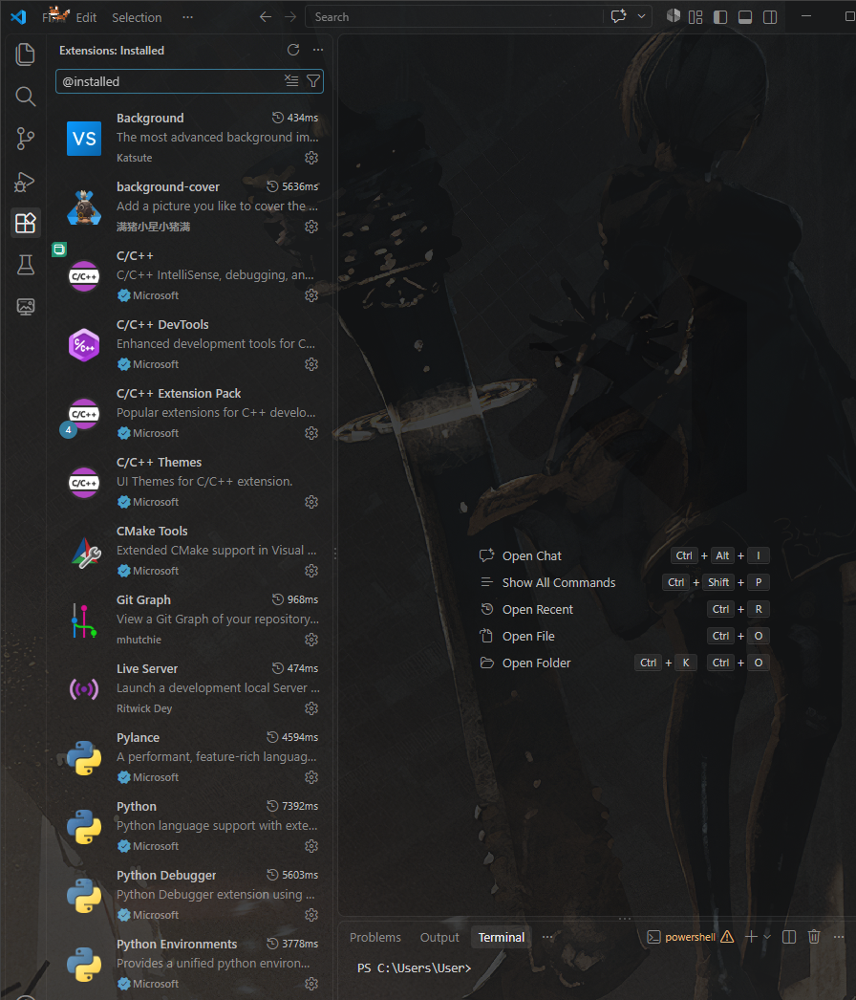
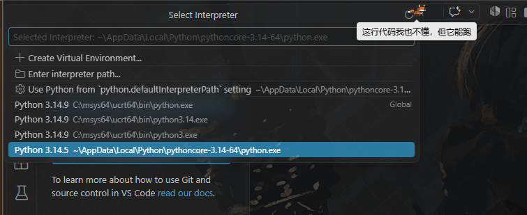
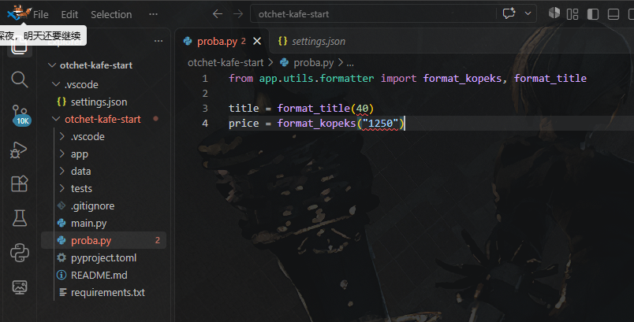
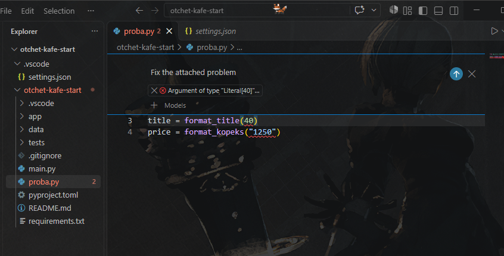
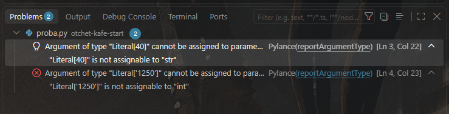
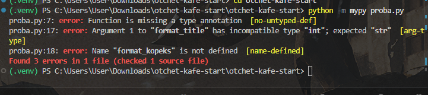
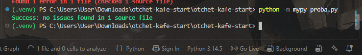

# Отчёт · Проверка типов: Pylance и mypy

**Студент:** Геращенко Ксения 9/2-РПО-25/3

## 1. Подготовка





## 2. Проверка в редакторе

```python
from app.utils.formatter import format_kopeks, format_title

title = format_title(40)
price = format_kopeks("1250")
```





Разбор сообщения:

| Часть сообщения | Что означает |
|---|---|
| Argument of type "Literal[40] | передан аргумент типа Literal[40]. Так Pylance называет тип конкретного значения: «ровно число 40». Это частный случай int |
| cannot be assigned to parameter "text" of type "str" | нельзя передать в параметр text, который ожидает строку |
| in function "format_title" | функция, которую вызывали |
| "Literal[40]" is not assignable to "str" | короткая причина: число не подходит туда, где ждут строку |
| Pylance(reportArgumentType) | кто сообщил и по какому правилу. По имени правила его находят в документации |



## 3. Проверка в терминале

```text
roba.py:7: error: Function is missing a type annotation  [no-untyped-def]
proba.py:17: error: Argument 1 to "format_title" has incompatible type "int"; expected "str"  [arg-type]
```



```text
Success: no issues found in 1 source file
```

## 4. Проект без аннотаций

| Этап | Итог `mypy app` |
|---|---|
| исходно | 18 errors |
| после `utils` | 12 errors |
| после `domain` | 8 errors |
| после `services` | 3 errors |
| после `ui` | Success: no issues found |

Модуль до и после — app.utils.formatter:

```python
# Подписи функций без аннотаций (первый архив проекта)
def format_title(text, width=40):
    ...

def format_kopeks(kopeks):
    ...
```

```python
# Те же подписи с аннотациями (второй архив проекта)
def format_title(text: str, width: int = 40) -> str:
    ...

def format_kopeks(kopeks: int) -> str:
    ...
```

```text
# вывод: mypy app, python -m pytest -q, python main.py
(.venv) PS C:\...\otchet-kafe-start> mypy app
Success: no issues found in 15 source files

(.venv) PS C:\...\otchet-kafe-start> python -m pytest -q
........                                                                 [100%]
8 passed in 0.12s

(.venv) PS C:\...\otchet-kafe-start> python main.py
=== КАФЕ ===
Чек №1: Кофе, 250.00 руб.
Чек №2: Чай, 150.00 руб.
Итого: 400.00 руб.
```



## 5. Выводы

Pylance и mypy проверяют код с аннотациями до его запуска: первый подчёркивает неверные вызовы прямо в редакторе во время набора, второй по команде проверяет весь проект и выдаёт отчёт в терминале. Неожиданным оказалось, что без включённого параметра disallow_untyped_defs mypy полностью игнорирует функции без аннотаций, считая проект идеальным, хотя проверять в нём нечего. Также выяснилось, что проверка типов не находит ошибки в данных (например, если в файле вместо числа окажется строка) или ошибки в логике вычислений — для этого нужны тесты. Главное правило: проверка типов ловит несовпадения с аннотациями, а тесты — ошибки во время выполнения.

